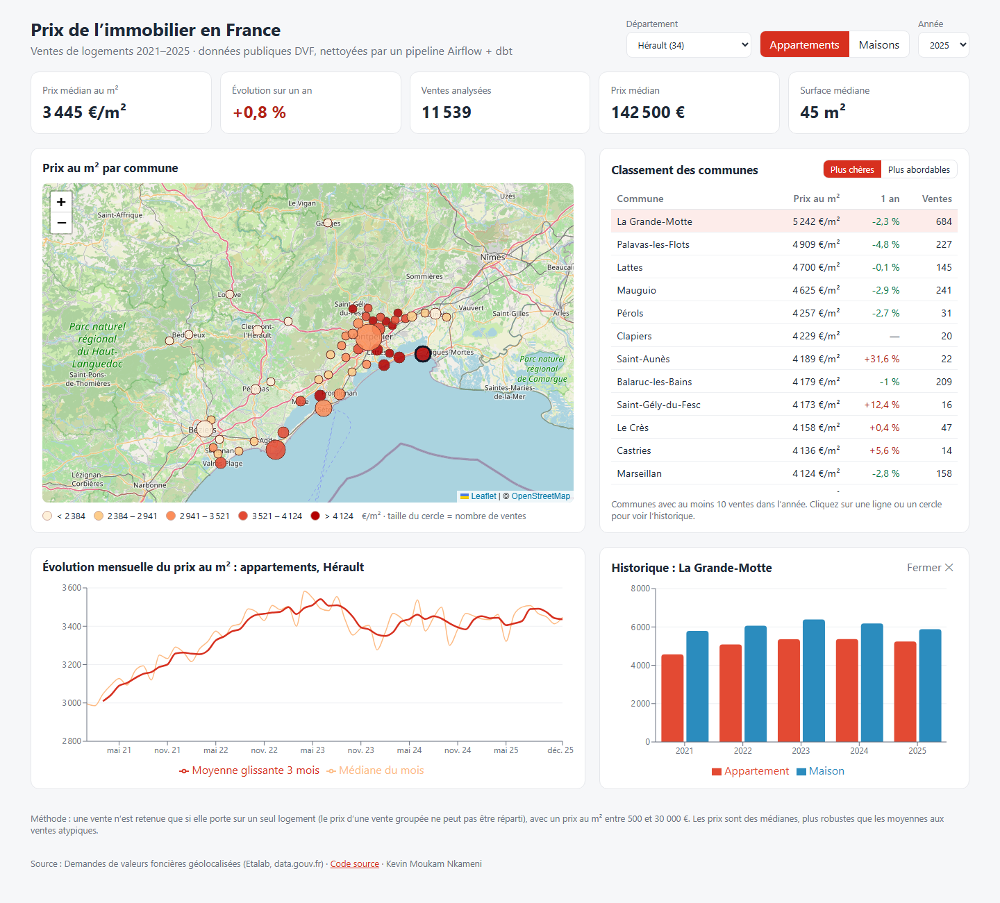

# Pipeline de données immobilières (DVF)

[](https://github.com/MKkevin2712/dvf-pipeline/actions/workflows/ci.yml)
[](https://github.com/MKkevin2712/dvf-pipeline/actions/workflows/pages.yml)

🌍 **Site en ligne** : [mkkevin2712.github.io/dvf-pipeline](https://mkkevin2712.github.io/dvf-pipeline/)

Pipeline de data engineering sur les **Demandes de valeurs foncières** (DVF) : toutes les ventes immobilières
publiées par l'État. Objectif : produire des indicateurs fiables de **prix au m²** par commune et par mois.

## Architecture

```
data.gouv.fr ──► ingestion Python ──► raw (texte brut) ──► dbt : staging ► intermediate ► marts ──► dashboard
                  (idempotente)        DuckDB ou PostgreSQL       (tests de qualité)
                                           orchestré par Airflow (Docker)
```

Le même projet dbt tourne sur **DuckDB** (local, CI) et **PostgreSQL** (Docker).

## Les pièges des données DVF, et leur traitement

| Piège | Conséquence si on l'ignore | Traitement (dbt) |
|---|---|---|
| Une vente = plusieurs lignes (logement, caves, parkings, parcelles), **prix répété sur chaque ligne** | prix multipliés | regroupement par mutation, prix pris une seule fois |
| 7 % des ventes portent sur **plusieurs logements** | prix au m² faux | exclusion de ces ventes |
| Parcelles situées dans **deux communes** | vente attribuée à la mauvaise commune | localisation prise sur la ligne du logement |
| Prix au m² aberrants (vente à 1 €, lots de parkings…) | moyennes faussées | bornes de plausibilité (500–30 000 €/m²) et médiane |

Le troisième piège a été détecté par un **test dbt** (unicité commune × année × type).

## Orchestration (Airflow + PostgreSQL, avec Docker)

```bash
docker compose up -d --build        # PostgreSQL + Airflow 3 ; interface : http://localhost:8080
```

Le DAG `dvf_pipeline` s'exécute chaque mois :

```
ingestion  ──►  controle_volume  ──►  dbt_build
```

- **ingestion** : téléchargement et chargement idempotent dans `raw.dvf_mutations` (PostgreSQL) ;
- **controle_volume** : garde-fou, arrête le pipeline si moins de 100 000 lignes ont été chargées (source incomplète) ;
- **dbt_build** : modèles staging → intermediate → marts et 25 tests de qualité.

Chaque tâche est relancée 2 fois en cas d'échec, et deux exécutions ne peuvent pas tourner en même temps.
Résultat vérifié : **608 226 ventes** retenues, identiques sur PostgreSQL et DuckDB.

## Interface web (React + API FastAPI)



- **API FastAPI** (`src/dvf_pipeline/api.py`) : lit les tables `marts` produites par dbt (DuckDB ou PostgreSQL) ;
- **React + TypeScript** (`web/`, Vite) : chiffres clés, **carte** des prix par commune (Leaflet), classement,
  **évolution mensuelle** avec moyenne glissante (Recharts) et historique d'une commune au clic.

```bash
uv run uvicorn dvf_pipeline.api:app --port 8000      # API : http://127.0.0.1:8000/docs
cd web && npm install && npm run dev                 # interface : http://localhost:5173
```

Une commune n'apparaît que si elle compte au moins 10 ventes dans l'année : en dessous, une médiane n'est pas fiable.

**Version en ligne sans serveur** : `python -m dvf_pipeline.export_static` exporte les réponses de l'API en fichiers
JSON, que l'interface lit quand elle est compilée avec `VITE_STATIC=1`. Le workflow `pages.yml` exécute chaque mois
toute la chaîne (ingestion → dbt → export → compilation) et publie le site sur GitHub Pages.

## Lancer le projet en local (sans Docker)

```bash
uv sync
uv run python -m dvf_pipeline.ingest          # télécharge et charge 5 ans × 5 départements (≈ 2,3 M lignes)
cd dbt && uv run dbt build --profiles-dir .   # transformations + 25 tests
uv run pytest                                 # tests de l'ingestion
```

## Plan

- [x] Ingestion idempotente (DuckDB et PostgreSQL)
- [x] Modèles dbt staging / intermediate / marts et tests de qualité
- [x] Docker Compose : PostgreSQL + Airflow 3
- [x] DAG Airflow mensuel : ingestion → contrôle de volume → dbt build (relances automatiques)
- [x] API FastAPI et interface web React (carte, classement, évolution mensuelle, historique par commune)
- [x] CI GitHub Actions : ruff, pytest, ingestion d'un échantillon réel + dbt build, lint et compilation React
- [x] Publication automatique sur GitHub Pages, chaque mois (chaîne complète, sans serveur : indicateurs exportés en JSON)

## Auteur

Kevin Moukam Nkameni — [github.com/MKkevin2712](https://github.com/MKkevin2712)
